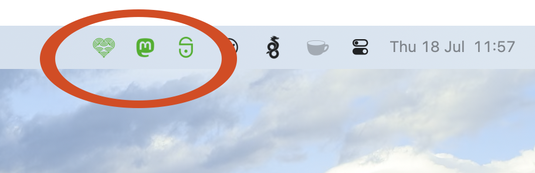

# thruk-anybar
Show a general status from [Thruk](https://www.thruk.org) in [AnyBar](https://github.com/tonsky/AnyBar).

Patches are welcome!




## Prerequisites

* Install Anybar
```
brew install anybar
```
* Install [uv](https://docs.astral.sh/uv/). Apple's python3 has no TLS 1.3 support, so
  `INSTALLER` uses uv to create a venv in `~/.Anybar/venv` on a standalone python
  (version set by `PYTHON_VERSION` in `INSTALLER`) and installs the needed modules there
```
brew install uv
```

## Installation
* Run `./INSTALLER`
* Create/edit `~/.Anybar/thruk-anybar.toml` (see example below)
* Create (or copy from `icons/`) icons for your sites to `~/.Anybar`. Naming schema `SITE-COLOR@2x.png` (read more about colors below)


## Configuration
Configuration is done via `~/.Anybar/thruk-anybar.toml`, a simple TOML file. Each site get it's own table. Increse port number for each site. The site name (table name) must be named as the icons.
The API key can be created in Thruk under User Profile. E.g https://monitor.example.com/thruk/cgi-bin/user.cgi#apikeys
```
[swamid]
baseurl = "https://monitor.swamid.se"
key = "REDACTED"
port = 1738

[mastodon]
baseurl = "https://monitor.social.sunet.se"
key = "REDACTED"
port = 1739

[geteduroam]
baseurl = "https://monitor.geteduroam.sunet.se"
key = "REDACTED"
port = 1740
```

## Colors of icon

|Color|HEX|Status|
| --- | --- | --- |
|Green|#1eb100|Everything is OK in the monitor|
|Red|#ed230d|Attention is needed|
|Yellow|#f7ba00f7|`thruk-anybar.py` is in vacation mode|
|Black|#000000|Connection error or not yet run|
|Purple|#ca2a7a|thruk didn't respond with a proper json, server error?|
